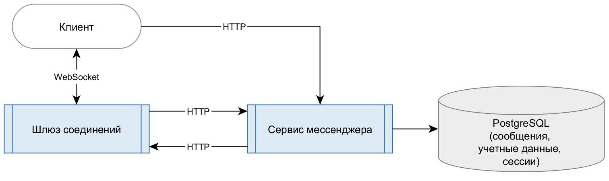

# Акт 1. MVP.

Выполнено проектирование мессенджера, отвечающего минимальным функциональным требованиям, описанным в [задании](../../TASK.md).

1. [Выбран набор компонентов архитектуры](./components.md)
2. [Приняты решения, связанные с реализацией](./decisions.md)
3. [Выбраны средства реализации](./stack.md)
4. [Приняты упрощения для MVP](./mvp.md)
5. [Разработаны сценарии](./scenarios.md)
6. [Спроектирована схема базы данных](./database.md)

В черновом формате выполнено описание в формате SQL [схемы базы данных](./schema.sql) и [запросов](./transactions.sql), выполняющих в БД операции, необходимые для функционирования мессенджера.
