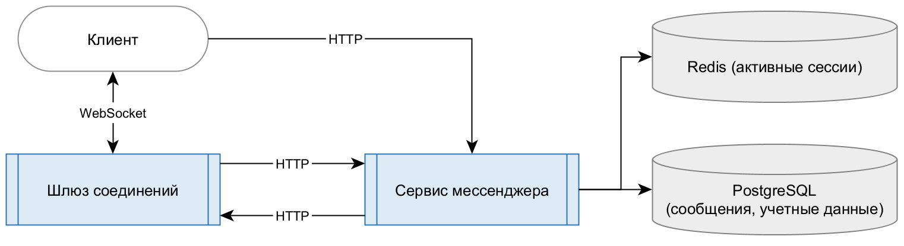

# Средства реализации

## Сервисы

Для реализации всех сервисов выбран язык программирования `Golang`.
Обоснование выбора:

- высокая производительность
- высокая степень контроля на этапе компиляции
- низкое потребление оперативной памяти
- наличие горутин для множества одновременных соединений

Сервисы:

**С1. Шлюз соединений**

**С2. Менеджер соединений**

**С3. Сервис мессенджера**

## Базы данных

**Б1. Учетные данные пользователей**: `PostgreSQL`, подходит для управления структурированными учетными данными и профилями пользователей.

**Б2. Сообщения**: `PostgreSQL`, как начальное решение, соответствующее требованиям по скорости записи и чтения. Возможность поиска сообщений по строке.

Далее возможно использование `Apache Cassandra` для увеличения скорости записи с удобным масштабированием.

**Б3. Соединения**: `Redis`, в силу простой структуры данных и высокой скорости доступа к ним.

**Б4. Активные сессии**: `Redis`, причины аналогичны описанным для активных соединений.

## Дополнительные системы

**Д1. Pub/sub для событий инвалидации сессий**: `Redis`, так как имеет встроенную поддержку технологии подписчик-издатель.

## Упрощения для MVP

**Б1** и **Б2** объединены в единую сущность `PostgreSQL`, разделены на уровне таблиц. 
**С1** и **С2** объединены в единый сервис **C12** в силу наличия единственного шлюза.

**Д1** упразднен: сервис мессенджера **C3** сообщает об инвалидации сессий шлюзу **C12** напрямую. 
**Б3** упразднен: шлюз **C12** ведет учет соединений самостоятельно в памяти процесса.

## Итоговый начальный стек

**I. Шлюз соединений:** поддержка соединений с клиентами и доставка сообщений. 
**II. Сервис мессенджера:** вся логика обработки сообщений, управление аккаунтами. 
**III. PostgreSQL:** долговременное хранение сообщений, профилей, прочих учетных данных. 
**IV. Redis:** хранение активных сессий.

## Схема компонентов системы

