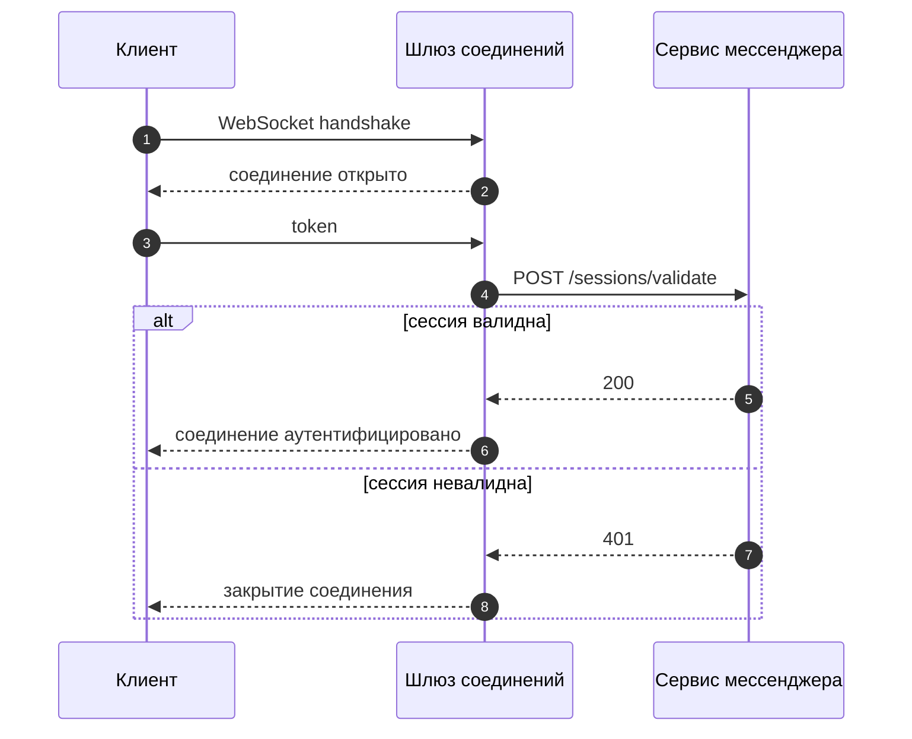
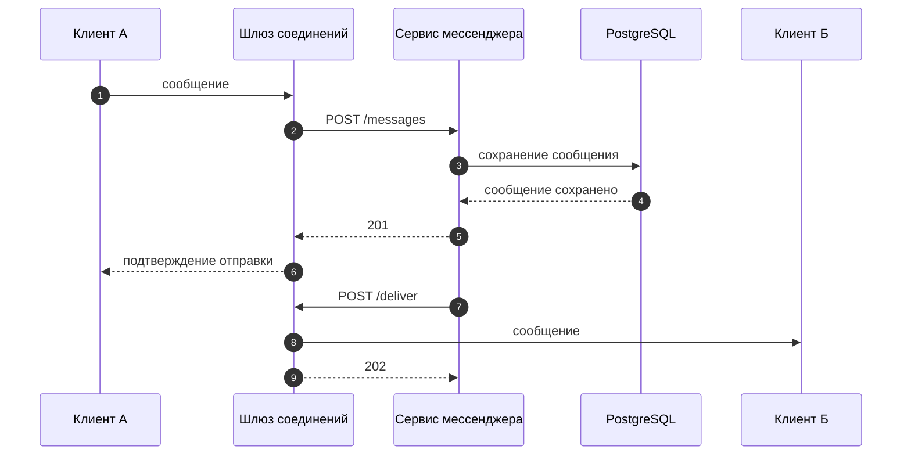
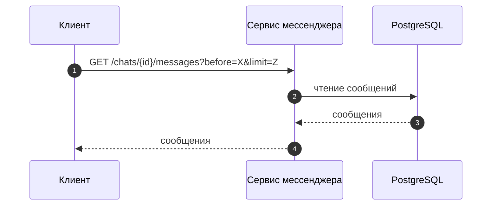
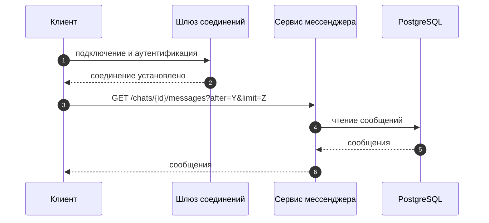

# Сценарии взаимодействия

В рамках MVP принято, что чат открыт пользователем исключительно на одном устройстве в один момент времени.
События, связанные с добавлением/удалением из чата, удалением самого чата и другими событиями, не связанными с доставкой сообщений, не передаются в режиме реального времени.

## Подключение с аутентификацией

## Отправка сообщения

## Загрузка истории сообщений

Выполняется при просмотре пользователем сообщений в прошедшем времени с пагинацией вверх.

## Загрузка новых сообщений

Выполняется при подключении к шлюзу соединений для подгрузки сообщений, пришедших во время отсутствия соединения.

